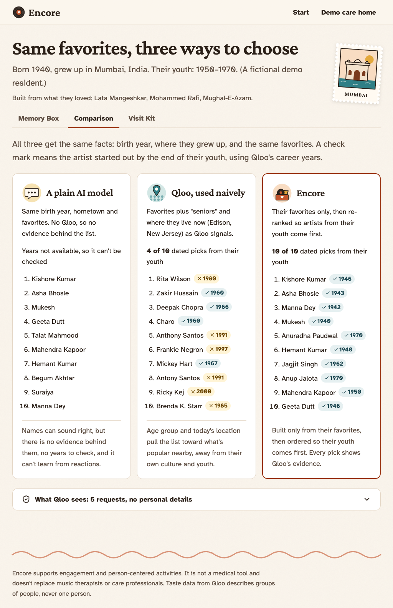
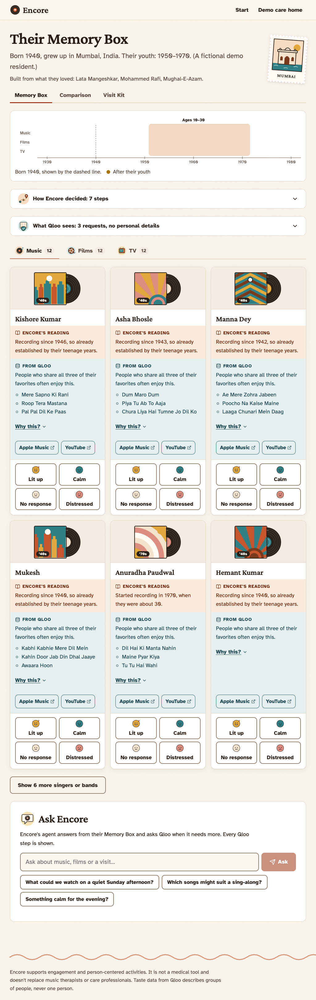
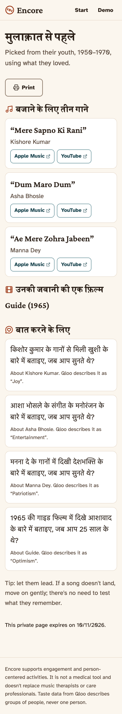
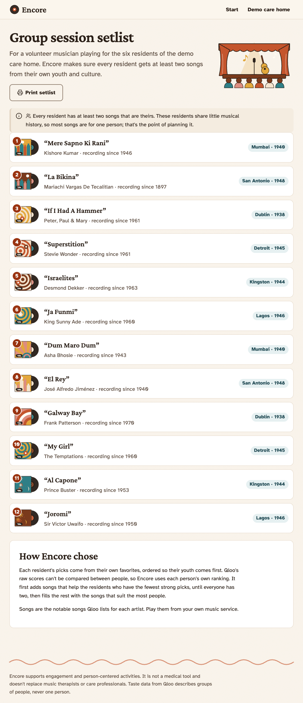
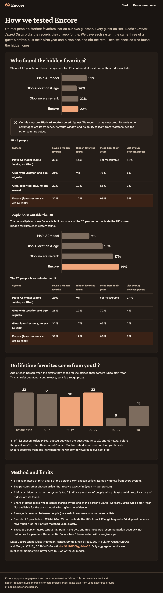
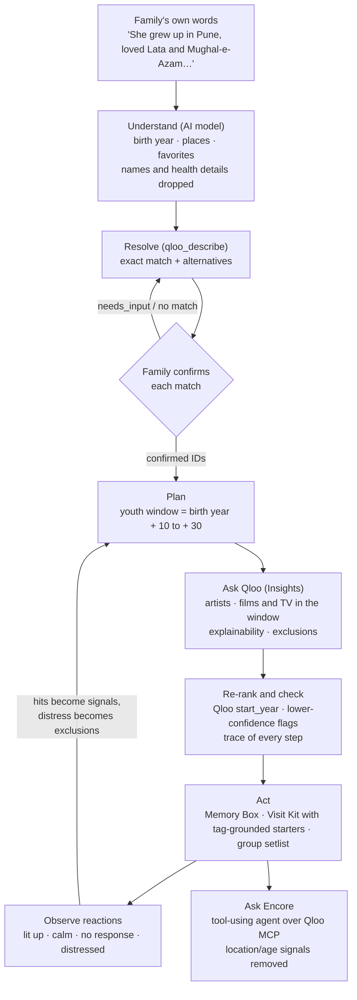
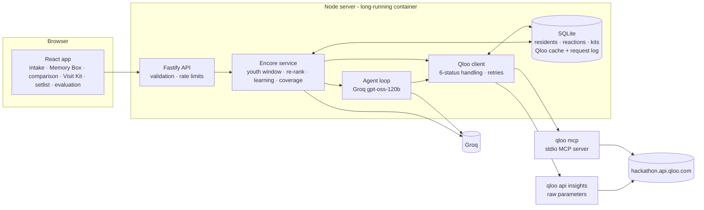

# Encore

*The songs, films and shows that still bring them back.*

Encore is a care-team agent for dementia and elder care. A family describes what someone loved when they were young; Encore uses [Qloo](https://www.qloo.com/)'s taste graph to find the music, films and TV from **their own youth and culture**, turns it into activities, Visit Kits and group setlists, and **learns from how the person responds**. It supports engagement and person-centered activities; it is not a medical tool and doesn't replace music therapists or care professionals.



- [The problem](#the-problem)
- [The idea: familiarity, not novelty](#the-idea-familiarity-not-novelty)
- [What Encore does](#what-encore-does)
- [Who pays](#who-pays)
- [How the agent works](#how-the-agent-works)
- [What makes Encore Qloo-powered](#what-makes-encore-qloo-powered)
- [A request, start to finish](#a-request-start-to-finish)
- [Evaluation on real people](#evaluation-on-real-people)
- [Privacy and safe use](#privacy-and-safe-use)
- [Architecture](#architecture)
- [Run it](#run-it)
- [Known limitations](#known-limitations)
- [Sources](#sources)

## The problem

- More than 7 million Americans live with Alzheimer's, cared for by more than 12 million unpaid family caregivers ([Alzheimer's Association, 2026 Facts and Figures](https://www.alz.org/getmedia/3b8467f1-973a-42ca-869b-61a6b195e9fd/2026-Facts-and-Figures-Statesheets-Ohio-1.pdf)).
- US nursing homes must offer activities that meet **each resident's** interests ([CMS F679, 42 CFR 483.24(c)](https://ltc.health.mo.gov/wp-content/uploads/sites/18/2024/06/1.-Activities-for-Special-Populations-2.pdf)). Preferences are gathered with the MDS Section F interview, which asks about things like listening to music and, when the resident can't answer, is done with **family** ([Maine DHHS MDS training](https://www.maine.gov/future/sites/maine.gov.dhhs/files/documents/dlc/training/f/f.html), [LOINC 54520-2](https://loinc.org/54520-2/)).
- Musical memory is relatively spared in Alzheimer's ([Jacobsen et al., 2015, *Brain*](https://www.sciencenews.org/article/alzheimers-spares-brains-music-regions)), and personalized music programs are popular. The evidence on outcomes is honestly mixed: an observational study linked one program to less antipsychotic use ([Brown University, 2017](https://www.brown.edu/news/2017-05-10/music)), but the randomized METRIcAL trials found no effect on agitation as measured by MDS records or staff reports ([NCT04850807](https://clinicaltrials.gov/study/NCT04850807), [PMC11690236](https://www.ncbi.nlm.nih.gov/pmc/articles/PMC11690236/)). A secondary analysis looks at what limits adherence ([PMC12064317](https://www.ncbi.nlm.nih.gov/pmc/articles/PMC12064317/)).
- **Encore's claim is narrow:** it makes person-centered, culturally right activity planning fast enough that busy staff and families actually do it. It makes no claim about clinical outcomes.
- **The cultural gap:** generic "oldies" lists serve one culture. An Indian grandmother in a New Jersey care home gets Sinatra. That is the hackathon's "culturally blind" problem in a setting where it matters.

## The idea: familiarity, not novelty

Most recommenders hunt for something new. **Encore deliberately hunts for familiarity**, because in dementia care recognition matters more than discovery.

People remember best what they met between about ages 10 and 30 (the *reminiscence bump*). Encore works out that window from the birth year, asks Qloo for what people with the same favorites love, and orders the results so the person's youth comes first.

## What Encore does

| Feature | What it is | Try it |
|---|---|---|
| **Story intake** | A family describes the person in their own words. Encore's agent fills in the form (birth year, places, favorites), dropping names and health details. Every favorite is then resolved in Qloo and **confirmed by the family**, because names collide ("Rafi" exactly matches a different artist). | `/start` |
| **Memory Box** | Music, films and TV from their youth. Each card separates **Encore's reading** (when it came out, how old they were) from **Qloo's evidence** (which favorite led there, affinity, Qloo's list of notable songs). A **life timeline** shows ages 10–30 and where every pick falls. | any resident |
| **Learning loop** | One-tap reactions: *lit up / calm / no response / distressed*. Hits are pinned and become new Qloo signals; distress excludes an item for good, and Encore **asks** before also avoiding similar Qloo themes. | react on a card |
| **How Encore decided** | A plain-language trace of every step: the window, the signals, each Qloo request and its status, the re-rank, exclusions, and lower-confidence warnings. | Memory Box |
| **Ask Encore** | A tool-using agent (Groq `gpt-oss-120b` over Qloo's MCP tools) grounded in the Memory Box. Every Qloo step it takes is shown; location and age signals are stripped before any call. | Memory Box |
| **Comparison** | The same intake through a plain AI model, Qloo used naively (favorites + "seniors" + where they live now), and Encore, with each Qloo pick checked against the person's youth. | Comparison tab |
| **Family Visit Kit** | A private link with three songs, a film and conversation starters **built from Qloo's tags**, in English, Hindi or Spanish. No names; expires in 30 days; revocable. | Visit Kit tab |
| **Group session** | A setlist for a volunteer musician playing for a room of residents: a coverage algorithm makes sure every resident gets at least two songs that are theirs. | `/group` |
| **Evaluation** | Results on real people's lifetime favorites, including where Encore loses. | `/evaluation` |

The landing page offers two doors: **try it on someone you love**, or **a 90-second guided tour** through a fictional resident who grew up in Mumbai. The demo care home has six fictional residents from Mumbai, San Antonio, Dublin, Detroit, Kingston and Lagos; each visitor works on a private copy.

| | |
|---|---|
|  |  |
|  |  |

## Who pays

- **Buyer:** activity directors at US nursing homes and memory-care communities. There are 14,742 CMS-certified nursing homes with about 1.24 million residents ([KFF, July 2025](https://www.kff.org/medicaid/a-look-at-nursing-facility-characteristics/)) and about 32,000 assisted-living and residential-care communities ([A Place for Mom, citing NCHS 2022](https://aplaceformom.com/senior-living-data/assisted-living-statistics)).
- **Why they pay:** they already have to deliver person-centered activities (F679) and record preferences (MDS Section F). Encore turns a family interview into a ready plan in seconds instead of hand-building playlists, and its reactions log documents what landed. (Encore supports that work; it doesn't certify compliance.)
- **Pricing (proposal):** per resident per month. For scale, at $3 per resident per month, US nursing homes alone would be about $45 million a year (1.24 million × $3 × 12). That's illustrative arithmetic, not a forecast.
- **Growth loop:** Visit Kits are free for families. A family that uses one before visiting is the natural person to bring Encore to their relative's care home.
- **Path to production:** HIPAA business-associate and facility data agreements, and integration with the care home's own records. Not built in this demo, which stores no real people's data.

## How the agent works

Encore's agent turns a family's words into a plan, using Qloo as its source of truth and asking a person whenever a match is uncertain.



Every arrow into Qloo is cached, logged as sent (the "What Qloo sees" panel) and handled for all six statuses.

## What makes Encore Qloo-powered

Encore talks to Qloo only through Qloo's official harness: the kit's `qloo mcp` server for workflows, and `qloo api insights --params` (inside the harness) for raw Insights parameters the workflows don't expose. Every request is cached, logged exactly as sent, and handled for all six statuses (`ok`, `empty`, `needs_input`, `partial`, `degraded`, `error`; "ok with zero results" is treated as `empty`, which we saw happen).

| Job in Encore | Qloo tool | Why it fits |
|---|---|---|
| Turn what a family typed into entities | `qloo_describe` | Returns the match type and alternatives, which power the "Is this who you meant?" step |
| Artists people with these favorites love | Insights (`artist`, favorites as `signal.interests.entities`, 40 results, `feature.explainability`) | Cross-domain taste affinity an AI model can't ground; explainability says which favorite led to each pick |
| Films and TV from their youth | Insights (`movie` / `tv_show`, `filter.release_year.min/max` = ages 10–30) | Without the window 0 of 75 films were from the person's youth; with it, 75 of 75 ([spike](docs/spike.md)) |
| When an artist started out | Qloo's own `start_year` / `date_of_birth` properties | Re-ranks artists so their youth comes first; no outside lookups needed |
| Song titles for kits and setlists | Qloo's `notable_songs` property | Lets families play songs, not just artists |
| Never suggest it again | Insights `filter.exclude.entities` / `filter.exclude.tags` | Distress and staff-chosen themes are enforced by Qloo itself |
| Conversation starters and "similar themes" | `qloo_entity_tags` | Starters must cite a real Qloo tag or they are replaced |
| The naive comparison column | `qloo_recommend` with `demographic: "seniors"` and `signal_location`, then Insights `filter.entities` for career years | Shows, with Qloo's own data, what a straightforward integration does |
| Ask Encore | the agent can use `qloo_describe`, `qloo_recommend`, `qloo_rank`, `qloo_entity_tags`, `qloo_find_tags`, `qloo_where_popular`, `qloo_audience_demographics`, `qloo_compare_audiences` | The agent plans its own calls; `qloo_trends` is not exposed because Encore has no job for it |

**What we learned about Qloo, and built around:**
- Location and age signals **erase culture** for people from minority backgrounds: favorites + "seniors" + a US city turned a Mumbai-born persona's list into Rita Wilson, Deepak Chopra and Charo; "Mumbai" as the location returned nothing. So Encore's candidate pool comes from favorites only, and the agent's location/age arguments are removed in code.
- `qloo_audience_demographics` separates classic from modern audiences cleanly (55+ skew about +0.3 to +0.7 for Patsy Cline, The Supremes, Sinatra; about −0.5 for Taylor Swift, Bad Bunny, Billie Eilish), which validated the generational framing.
- The harness defaults to production; hackathon keys need `qloo config set base-url https://hackathon.api.qloo.com`.

Details: [docs/spike.md](docs/spike.md).

## A request, start to finish

A fictional resident born 1940 who grew up in Mumbai; the family typed "Lata Mangeshkar", "Mohammed Rafi" and "Mughal-e-Azam".

1. **Resolve and confirm.** `qloo_describe {"entity":"Lata Mangeshkar","type":"artist"}` returns an exact match plus alternatives ("Lata Mangeshkar, Mukesh", …). The family confirms each.
2. **Ask Qloo.** Three requests in parallel, built only from the confirmed IDs:
   ```json
   { "type": "movie", "signals": ["D32E8668-…", "3233A07F-…", "23E081CF-…"], "take": 20,
     "params": { "feature.explainability": true, "filter.release_year.min": 1950, "filter.release_year.max": 1970 } }
   ```
   This is exactly what the "What Qloo sees" panel shows: entity IDs and a range of years. No name, no hometown, no health detail.
3. **Re-rank.** Of 40 artists, 26 started after 1972; Encore moves them below the ones from her youth using Qloo's `start_year`.
4. **Result.** Music: Kishore Kumar ("Mere Sapno Ki Rani"), Asha Bhosle, Manna Dey, Mukesh. Films: *Guide* (1965), *Mother India* (1957), *Padosan* (1968), *Shree 420* (1955). Each card says, for example, "People who share all three of their favorites often enjoy this" (Qloo) and "Came out in 1957, when they were about 17" (Encore).
5. **Learn.** Staff tap *lit up* on Kishore Kumar: he is pinned and added as a signal. They tap *distressed* on *Guide*: the next request carries `"filter.exclude.entities": "8591EA91-…"`, and Encore offers Qloo's themes for *Guide* ("Dancer", "In-Laws", …) to avoid as well.

## Evaluation on real people

**Ground truth comes from real people, not from us.** Every guest on BBC Radio's *Desert Island Discs* chooses the records they'd keep for life. We used the open dataset of every episode ([Finnegan, Rangel Smith & Van Stroud, 2021](https://doi.org/10.17613/2gg4-hw68), CC BY-NC-SA 4.0; built on Gustar 2020 and Morgan 2018).

- **Sample:** 30 guests born 1920–1965 drawn at random from 997 eligible, half born outside the UK; 23 evaluated (7 had fewer than 4 artists that matched Qloo exactly).
- **Task:** every system gets the same intake (birth year, place of birth, three of the guest's chosen artists) and must find the others in its top 20. **Names are never sent** to Qloo or the model.
- **Systems:** a plain AI model (same intake, no Qloo), Qloo with location and age signals, Qloo with favorites only (no era re-rank), and Encore.

| System | Found a hidden favorite | Hidden favorites found | Picks from their youth | List overlap between people |
|---|---|---|---|---|
| Plain AI model | **30%** | **16%** | not measurable | 16% |
| Qloo + location & age | 17% | 9% | 71% | 7% |
| Qloo, no era re-rank | 22% | 10% | 90% | 3% |
| **Encore** | 22% | 10% | **97%** | **3%** |
| *Born outside the UK (13):* plain AI model | 15% | 6% | – | |
| *Born outside the UK (13):* **Encore** | **31%** | **15%** | 94% | |

**Reading it honestly:**
- Across everyone, **the plain AI model did better** at finding hidden favorites. These are mostly British public figures choosing well-known music, which large models know well.
- For guests **born outside the UK**, Encore found a hidden favorite **twice as often** as the plain model: the culturally-blind case Encore exists for.
- Encore keeps **97%** of picks in the person's youth versus 71% for naive Qloo, and its lists are about five times more personal than the plain model's. The era re-rank improves youth share, not hit rate.
- The sample is small; one or two people move these numbers. Treat them as early evidence.

**Do lifetime favorites come from youth?** Using Qloo's career start years for the artists guests chose: 41% started when the guest was 10–29, and 41% before the guest was 10 (often their parents' music). It's a rough proxy (artist debut, not song release), and it supports widening the window downwards as future work.

**Speed:** a brand-new person's Memory Box (36 picks, three Qloo requests in parallel) took 5.6 seconds; repeat views come from cache in about 7 ms. We have not measured caregiver time savings and don't claim any.

Reproduce: `python3 eval/prepare_sample.py` then `node eval/run-eval.mjs` (see [Run it](#run-it)). Only aggregates are published ([eval/results.json](eval/results.json)); the dataset's license forbids republishing it, so the scripts download it instead.

## Privacy and safe use

| Qloo may see | Qloo never sees |
|---|---|
| Confirmed entity IDs, tag IDs, a range of years, excluded IDs; for the naive comparison only, a city | Names, health or diagnoses, reactions, care notes, addresses, the care home's name, device or account IDs |

- There is **no name field anywhere**. Residents are anonymous IDs; intake asks for a birth year, places and favorites.
- **Reactions are behavioral data** and stay in Encore's database. Qloo only ever receives the resulting exclusion or signal IDs.
- The "What Qloo sees" panel is generated from the server's request log, never written by hand.
- The story intake text goes to the AI model, never to Qloo; the model is told to drop names and health details and to report what it dropped.
- Visit Kits use 192-bit random tokens; only a hash is stored. Links carry no names, expire in 30 days, and can be turned off.
- Qloo results describe groups of people. Encore says "People who love X often enjoy Y" and never presents an affinity as a prediction about one person.
- Encore never hosts or plays music. It links out to Apple Music and YouTube searches so people use their own subscriptions.
- The demo uses fictional residents only. Encore collects no data from real people.

**MDS Section F mapping** (activity preferences, F0500):

| F0500 preference | Encore |
|---|---|
| Listening to music they like | Memory Box music, Visit Kit songs, group setlist |
| Doing favorite activities | Films and TV from their youth, conversation starters |
| Doing things with groups | Group session setlist with per-resident coverage |
| Books, newspapers, magazines | Books can be given as favorites and used as Qloo signals |
| Religious services or practices | Never inferred; only what the family states |
| Animals, the news, going outside | Out of scope |

## Architecture



Encore must run as a long-lived server: the harness's MCP server is a local stdio process, so serverless platforms are not supported. The Docker image pins the harness, sets the hackathon base URL, and contains no secrets.

**Our own algorithms:** the youth window and era re-rank (`server/src/encore/era.ts`), Beta-Bernoulli learning from reactions with distress as a hard exclusion (`learning.ts`), greedy max-coverage setlists using per-resident normalized ranks because Qloo's scores aren't comparable across requests (`group.ts`), and tag-grounded starter validation (`starters.ts`). All are unit-tested.

## Run it

Requirements: Node.js 22.19 or newer, a Qloo hackathon API key, and a Groq API key.

```bash
npm install --global @qloo/qloo-harness                     # Qloo's official harness (provides `qloo mcp`)
qloo config set base-url https://hackathon.api.qloo.com     # hackathon keys don't work against production
cp .env.example .env                                        # then fill in QLOO_API_KEY and GROQ_API_KEY
npm install
npm run build
npm start                                                   # http://localhost:8080
npm test                                                    # 67 tests
```

For development, run `npm run dev` (API on :8080) and `npm run dev:web` (Vite on :5173, proxying `/api`).

**Docker:**

```bash
docker build -t encore .
docker run -p 8080:8080 --env-file .env -v encore-data:/app/var encore
```

On boot the server warms every demo resident's Qloo and model answers in the background (`PREWARM=false` to skip); with a persistent volume at `/app/var` that costs quota once.

| Health check | Checks | Uses Qloo quota |
|---|---|---|
| `/api/health` | The server is running | No |
| `/api/health/qloo` | The harness is connected and the credential is present | No |
| `/api/health/qloo/live` | One real, cached Qloo request succeeds | Once, then cached |

**Evaluation:** download the dataset into `data/` (see `eval/prepare_sample.py` for the source), then `python3 eval/prepare_sample.py && node eval/run-eval.mjs` with the same `.env` loaded.

## Known limitations

- Qloo affinities reflect **today's** aggregate tastes, not tastes from decades ago.
- Qloo works at the artist level; song titles come from Qloo's `notable_songs` list, not from what the person actually heard.
- Coverage is thinner for some catalogs. TV picks for a Mumbai-born person are American shows, because her favorites contain no TV and Indian TV barely existed then; Encore labels such sections lower confidence.
- Qloo sometimes has duplicate entities for one artist (two entries for Mohammed Rafi), so every match is confirmed by the family.
- AI-written text (starters, Ask Encore answers) can add small factual flourishes. Starters are restricted to Qloo's tags; agent answers are labelled as AI-written.
- The evaluation uses 23 mostly British public figures and measures recommendation accuracy, not outcomes for people with dementia. **Encore has not yet been tested with caregivers or residents.**
- A production version would need HIPAA business-associate and facility data agreements; this demo stores no real people's data.

## Sources

- Alzheimer's Association, 2026 Alzheimer's Disease Facts and Figures, state fact sheets: [example (Ohio)](https://www.alz.org/getmedia/3b8467f1-973a-42ca-869b-61a6b195e9fd/2026-Facts-and-Figures-Statesheets-Ohio-1.pdf); [alz.org/facts](https://www.alz.org/facts)
- CMS F679 (42 CFR 483.24(c)): [Missouri DHSS training material](https://ltc.health.mo.gov/wp-content/uploads/sites/18/2024/06/1.-Activities-for-Special-Populations-2.pdf)
- MDS 3.0 Section F: [Maine DHHS training](https://www.maine.gov/future/sites/maine.gov.dhhs/files/documents/dlc/training/f/f.html), [LOINC 54520-2](https://loinc.org/54520-2/)
- Jacobsen et al., 2015, *Brain*, musical memory in Alzheimer's: [Science News summary](https://www.sciencenews.org/article/alzheimers-spares-brains-music-regions)
- Thomas et al., 2017, *American Journal of Geriatric Psychiatry* (observational): [Brown University](https://www.brown.edu/news/2017-05-10/music)
- METRIcAL (randomized): [ClinicalTrials.gov NCT04850807](https://clinicaltrials.gov/study/NCT04850807), [PMC11690236](https://www.ncbi.nlm.nih.gov/pmc/articles/PMC11690236/), [PMC12064317](https://www.ncbi.nlm.nih.gov/pmc/articles/PMC12064317/)
- *Desert Island Disks* dataset: [doi:10.17613/2gg4-hw68](https://doi.org/10.17613/2gg4-hw68) (CC BY-NC-SA 4.0)
- Qloo: [hackathon developer guide](https://docs.qloo.com/reference/qloo-llm-hackathon-developer-guide), [hackathon kit](https://github.com/qloo/qloo-hackathon-kit)

## License

[MIT](LICENSE). The evaluation dataset is not included and keeps its own license.
